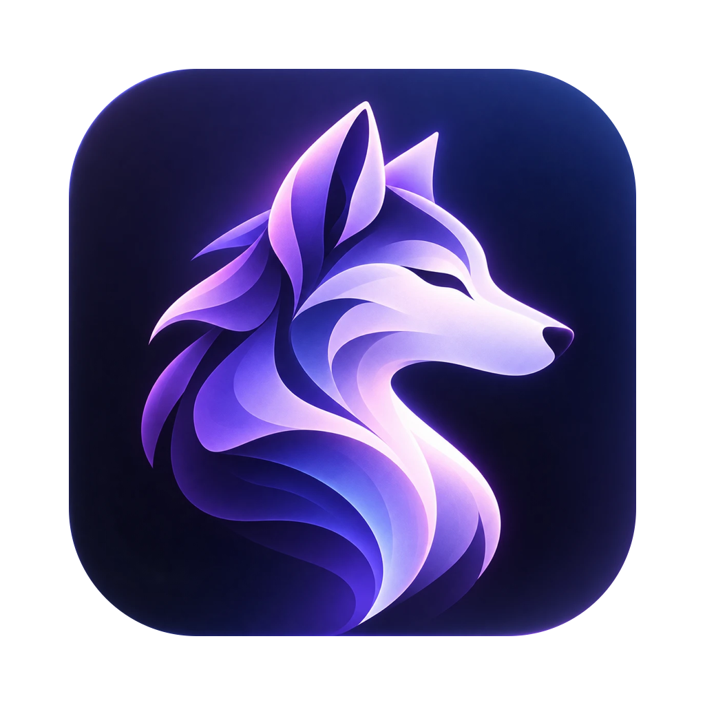

# Lupine



Hold **Fn**, speak, release — Lupine transcribes your voice locally with Whisper and pastes the
text wherever your cursor is. Nothing leaves your Mac.

## How it works

```
Fn held ──► native helper (CGEventTap) ──► Electron main ──► hidden recorder window (mic)
Fn released ──► 16 kHz WAV ──► whisper-cli + ggml-base.en ──► clipboard + ⌘V ──► clipboard restored
```

- `native/fn-helper.swift` — watches the Fn/globe key (Electron can't) and posts ⌘V.
- `src/main/dictation.js` — push-to-talk state machine (min hold 250 ms, max 2 min, Fn+key cancels).
- `src/main/whisper.js` — resample, write WAV, run `whisper-cli`, strip `[BLANK_AUDIO]`-style tags.
- `src/main/textInserter.js` — pastes via clipboard, then restores what you had copied.

## Setup

1. Requirements: macOS 14+, Node 22.23.4+, Xcode Command Line Tools (`swiftc`),
   `brew install whisper-cpp`, and the model at `models/ggml-base.en.bin`.
2. Stop macOS grabbing Fn: **System Settings → Keyboard → "Press 🌐 key to" → Do Nothing**.
3. Install and run:

   ```bash
   npm install
   npm start
   ```

4. Grant the prompts:
   - **Microphone** for Electron.
   - **Accessibility** for the app you launched from (e.g. Terminal), which the Fn helper
     inherits. Lupine retries every 2 s, so no restart is needed after granting.

The Lupine wolf appears in the menu bar; its menu shows permission status and the last error.

## Build a Mac app

```bash
npm run build   # dist/mac-arm64/Lupine.app
npm run dist    # dist/Lupine-0.1.0-arm64.dmg installer
```

Packaging uses [electron-builder](https://www.electron.build/) (free, MIT). The build:

- bundles the Fn helper (`Contents/Resources/bin`) and the Whisper model (`Contents/Resources/models`);
- runs from the menu bar only — no Dock icon (`LSUIElement`);
- includes the microphone usage description macOS requires (`NSMicrophoneUsageDescription`);
- is ad-hoc signed, which is enough to run it on your own Mac.

### Run the packaged app

1. Quit any running Lupine first (menu-bar wolf → Quit Lupine) — only one copy runs at a time.
2. Open it (or drag it into `/Applications` first):

   ```bash
   open dist/mac-arm64/Lupine.app
   ```

3. Allow **Microphone** and **Accessibility** for **Lupine** itself (not Terminal).

### Things to know

- **Size:** about 450 MB — Electron's framework plus the 148 MB `base.en` model.
- **Needs Homebrew Whisper:** `whisper-cli` is not bundled, so the Mac must have
  `brew install whisper-cpp`.
- **Permissions after rebuilds:** each ad-hoc build is a new identity to macOS, so it may ask for
  Microphone/Accessibility again. If so, remove the old Lupine entry in
  System Settings → Privacy & Security and grant it again.
- **Sharing with others:** without an Apple Developer ID ($99/year) other Macs show an
  "unidentified developer" warning (open with right-click → Open). Signing + notarization removes it.

### Icons

The logo lives in `assets/logo-source.webp`. After replacing it, regenerate the icons with:

```bash
npm run icons
```

This writes `build/icon.png` (1024 px app icon on Apple's grid, glow and shadow trimmed) and
`assets/tray.png` / `assets/tray@2x.png` (menu-bar icon). Then run `npm run build` again.

## Cost

Free. Electron, electron-builder, whisper.cpp and the Whisper model are all MIT-licensed, and
transcription runs on your Mac — no account, API key or per-minute charge. The only optional cost
is the Apple Developer Program, and only if you distribute the app to other people.

## Configuration

| Variable | Default |
|---|---|
| `LUPINE_MODEL` | `models/ggml-base.en.bin` |
| `LUPINE_WHISPER_CLI` | `/opt/homebrew/bin/whisper-cli`, then `/usr/local/bin/whisper-cli` |

## Tests

```bash
npm test
```

## Known limits

- English only (`base.en`); swap the model and the `-l en` flag for other languages.
- Unpackaged: permissions attach to whatever launches `npm start`. Packaging as a signed `.app`
  would give Lupine its own permission entries.
